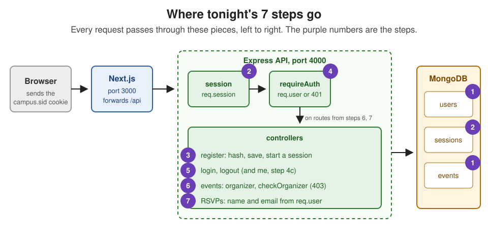
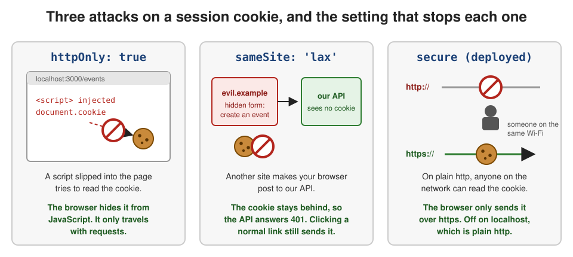

# Week 11 codealong: accounts, sessions and "is this yours?"

Tonight the app gets accounts. People register and log in, the API remembers them with a session, and only an event's organizer can change it, delete it or see who is coming. Open this folder in class. Everything is built except 7 steps in the API, cut into 30 small parts marked `TODO STEP` in the code.

Each step is cut into small parts (1a, 1b, 1c...). Every part sits exactly where its lines go, shows the few lines to type, and says why. Most parts end with a **Check** you can try right away. Do them in order: in the Todo Tree panel they're listed STEP 1a, 1b, 1c... from top to bottom.

Stuck on a part? Open the same file in [`../week11-auth`](../week11-auth). That's the finished version.

## Start (two terminals)

Use the same `MONGODB_URI` as last week. This week also needs a `SESSION_SECRET`.

Terminal 1, the API:

```bash
cd api
npm install
cp .env.example .env
# edit .env: paste your connection string after MONGODB_URI=
# and put a long random value after SESSION_SECRET= (this command makes one):
node -e "console.log(crypto.randomBytes(32).toString('base64'))"
npm run dev
```

Don't run `npm run seed` yet. It needs the User model from step 1.

Terminal 2, the Next.js app:

```bash
cd web
npm install
cp .env.example .env
npm run dev
```

Open http://localhost:3000/events. The events from last week are there, and the header has **Log in** and **Register** links. The web app is finished. Tonight we only change the API, so those pages answer "not built yet" until we write each route.

The admin pages (http://localhost:4000/admin/events) show an error until step 2.

## The steps

- [ ] **Step 1**, `api/src/models/User.js` and `Event.js` (1a to 1e): the User model with a unique email and a password hash that never leaves the API, and an `organizer` on every event. `npm run seed` makes Ava and Sam.
- [ ] **Step 2**, `api/src/session.js` and `app.js` (2a to 2d): sessions saved in MongoDB, and the cookie settings that keep the session id safe.
- [ ] **Step 3**, `api/src/controllers/auth.controller.js` (3a to 3e): register. Password rules, `bcrypt.hash()`, 409 for an email that's taken, and a session at the end.
- [ ] **Step 4**, `api/src/middleware/require-auth.js` and the same controller (4a to 4c): `requireAuth` reads the session. The header shows your name.
- [ ] **Step 5**, the same controller (5a to 5e): log in with `bcrypt.compare()` and one message for every failure, then log out.
- [ ] **Step 6**, `api/src/routes/events.routes.js`, `require-auth.js` and `events.controller.js` (6a to 6e): 401 when you aren't logged in, you become the organizer of what you create, and 403 when it isn't yours.
- [ ] **Step 7**, the routes and `rsvps.controller.js` (7a to 7c): RSVP as yourself, and only the organizer sees the RSVP list.

## Pictures for each step

Where every step goes in the app:



Steps 1 and 3, what bcrypt does with a password (animated):



Step 2, what each cookie setting stops:



Steps 3 to 5, the session and its cookie (animated):



Steps 6 and 7, 401 and 403 (animated):



## Demo accounts (after step 1)

| Name | Email | Password | Organizes |
|---|---|---|---|
| Ava Martin | `ava@example.com` | `campus-demo-ava` | Fall hackathon kickoff, Career fair prep workshop, Resume review drop-in, Midterm study skills session |
| Sam Lee | `sam@example.com` | `campus-demo-sam` | Thanksgiving residence potluck, Intramural ball hockey night, Student art show opening, Open mic night |

The passwords are fake and only exist in your own database.

## curl commands for steps 6 and 7

Run these in Git Bash, in the `api` folder. `-c` saves the cookie the API sends into a file, and `-b` sends it back, the way a browser does.

Step 6a, no cookie at all:

```bash
curl -i -X POST http://localhost:4000/api/events -H "Content-Type: application/json" -d '{"title":"Test"}'
```

Log in as each demo user once (after step 5):

```bash
curl -i -c ava.txt -X POST http://localhost:4000/api/auth/login -H "Content-Type: application/json" -d '{"email":"ava@example.com","password":"campus-demo-ava"}'
curl -i -c sam.txt -X POST http://localhost:4000/api/auth/login -H "Content-Type: application/json" -d '{"email":"sam@example.com","password":"campus-demo-sam"}'
```

Copy the `"id"` of **Fall hackathon kickoff** (one of Ava's events) from http://localhost:4000/api/events and use it in place of `ID`.

Step 6d, Sam changes Ava's event (403), then Ava does (200):

```bash
curl -i -b sam.txt -X PATCH http://localhost:4000/api/events/ID -H "Content-Type: application/json" -d '{"location":"Lab B"}'
curl -i -b ava.txt -X PATCH http://localhost:4000/api/events/ID -H "Content-Type: application/json" -d '{"location":"Lab B"}'
```

Step 6e, Sam deletes Ava's event (403):

```bash
curl -i -b sam.txt -X DELETE http://localhost:4000/api/events/ID
```

Step 7c, the RSVP list: no cookie (401), Sam (403), Ava (200):

```bash
curl -i http://localhost:4000/api/events/ID/rsvps
curl -i -b sam.txt http://localhost:4000/api/events/ID/rsvps
curl -i -b ava.txt http://localhost:4000/api/events/ID/rsvps
```

Delete `ava.txt` and `sam.txt` when you're done. They hold a working login.
