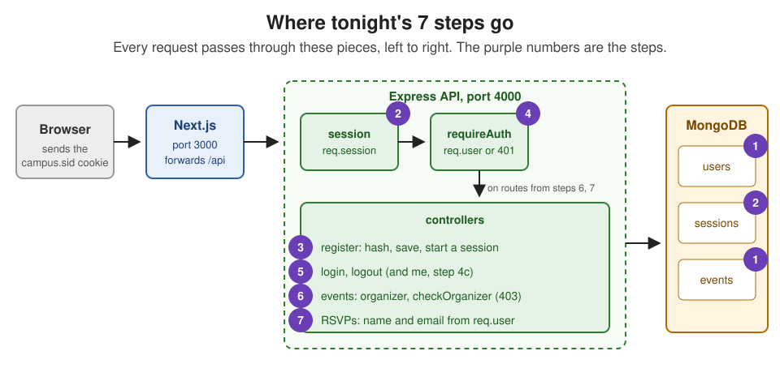
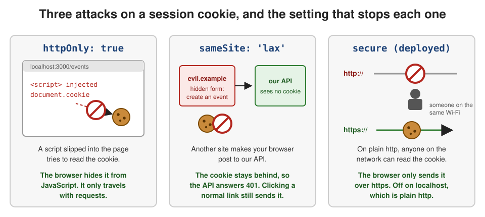

# Week 11: Accounts and sessions

The Week 10 app with accounts. People register and log in, the API remembers them with a session stored in MongoDB, and the routes that change data check who is asking. Only an event's organizer can change it, delete it or see who is coming. RSVPs use the logged-in user's name and email.

This is the finished version. In class, open [`../week11-auth-codealong`](../week11-auth-codealong) instead.

| Folder | What it is |
|---|---|
| `api/` | The Express API (port 4000): register, login, logout, sessions in MongoDB, `requireAuth` and organizer checks. The EJS admin pages have their own login form. |
| `web/` | The Next.js app (port 3000): login and register pages, your name in the header, and `proxy.js` sending logged-out visitors from `/events/new` to the login page |

## Run both (two terminals)

Terminal 1, the API:

```bash
cd api
npm install
cp .env.example .env
# edit .env: set MONGODB_URI, and put a long random value after SESSION_SECRET= (this command makes one):
node -e "console.log(crypto.randomBytes(32).toString('base64'))"
npm run seed
npm run dev
```

Terminal 2, the Next.js app:

```bash
cd web
npm install
cp .env.example .env
npm run dev
```

Run `npm run seed` again if your database still has last week's events. Events now need an organizer.

## Demo accounts

`npm run seed` makes two accounts. The passwords are fake and only exist in your own database.

| Name | Email | Password | Organizes |
|---|---|---|---|
| Ava Martin | `ava@example.com` | `campus-demo-ava` | Fall hackathon kickoff, Career fair prep workshop, Resume review drop-in, Midterm study skills session |
| Sam Lee | `sam@example.com` | `campus-demo-sam` | Thanksgiving residence potluck, Intramural ball hockey night, Student art show opening, Open mic night |

Log in as Ava in one browser window and as Sam in a private window to see the 403 rules.

## Pictures







The cookie holds a random id and nothing else. The session document in MongoDB holds `userId`. On every request, `requireAuth` finds the session from the cookie and loads the user.





`session-login.svg` and `401-vs-403.svg` are the same two diagrams without the animation, for printing.

## New and changed routes

| Method | Path | Who | Success | Errors |
|---|---|---|---|---|
| POST | `/api/auth/register` | anyone | 201 and a session cookie | 400, 409 email taken |
| POST | `/api/auth/login` | anyone | 200 and a session cookie | 401 (one message for a wrong email or password) |
| POST | `/api/auth/logout` | anyone | 204, session deleted, cookie cleared | |
| GET | `/api/auth/me` | logged in | 200 with the user | 401 |
| POST | `/api/events` | logged in | 201, you are the organizer | 400, 401 |
| PATCH, DELETE | `/api/events/:id` | the organizer | 200, 204 | 401, 403, 404 |
| POST | `/api/events/:id/rsvps` | logged in | 201 with your name and email (no body) | 401, 404, 409 |
| GET | `/api/events/:id/rsvps` | the organizer | 200 | 401, 403, 404 |

Reading events stays public. No response ever includes `passwordHash`.

The admin pages: `/admin/login` shows a login form, `POST /admin/logout` logs out, and every other `/admin` page sends you to the login form when nobody is logged in. Delete only shows on your own events.

## What changed since Week 10

| File | Change |
|---|---|
| `api/src/models/User.js` | New. Name, a unique lowercase email, and `passwordHash`, which `toJSON` never sends |
| `api/src/models/Event.js` | New `organizer` field, a reference to a User |
| `api/src/session.js` | New. `express-session` with `connect-mongo`, the cookie settings, and a stop with a message when `SESSION_SECRET` is missing |
| `api/src/utils/session.js` | New. `startUserSession()` and `endUserSession()`, which wrap express-session's callbacks in promises |
| `api/src/controllers/auth.controller.js`, `routes/auth.routes.js` | New. Register (bcrypt at cost 12), login, logout, me |
| `api/src/middleware/require-auth.js` | New. `requireAuth` (401), `requireAdminLogin` (redirect) and `checkOrganizer` (403) |
| `api/src/routes/events.routes.js`, `controllers/events.controller.js`, `rsvps.controller.js` | `requireAuth` on the routes that change data, the organizer from the session, RSVPs from the logged-in user |
| `api/src/controllers/admin.controller.js`, `views/login.ejs`, `views/partials/header.ejs`, `views/events-index.ejs` | Admin login and logout |
| `api/scripts/seed.js` | Two demo users, an organizer for every event |
| `api/examples/jwt-with-jose.js` | New. Signs a JWT, then shows a tampered, an expired and a wrong-audience token being rejected |
| `web/components/AuthProvider.js`, `UserMenu.js` | New. Asks `/api/auth/me` once and shares the user; the header shows Log in or your name |
| `web/components/LoginForm.js`, `RegisterForm.js`, `web/app/login`, `web/app/register` | New. The two forms and their pages |
| `web/lib/next-path.js` | New. Only allows `?next=` values that are paths on this site |
| `web/proxy.js` | New. Sends `/events/new` to the login page when there is no session cookie |
| `web/components/RsvpForm.js` | One RSVP button for logged-in users, a login link for everyone else |
| `web/app/events/new/page.js` | A "Log in again" link when the API answers 401 |

## Things to notice

- **The password is never saved.** Only the bcrypt hash is. bcrypt is slow on purpose and adds a random salt, so two people with the same password get different hashes. It reads only the first 72 bytes, so the API refuses longer passwords.
- **One message for a failed login.** "Email or password is incorrect" for both an unknown email and a wrong password, so the login form can't be used to check who has an account.
- **httpOnly, sameSite and secure.** Page scripts can't read the cookie, other sites can't post forms with it, and when deployed it only travels over HTTPS.
- **Sessions survive a restart.** Log in, stop the API, start it again: you are still logged in, because the session is in the `sessions` collection. Open it in Compass to see what's stored.
- **`proxy.js` is not the lock.** It only checks that a cookie called `campus.sid` exists. A fake or old cookie gets past it, and the API still answers 401. `requireAuth` is what protects the data.
- **Cookies through the rewrite.** The browser calls `/api/...` on port 3000 and Next.js forwards it, so the cookie belongs to the Next.js site and goes with every later `/api` call. No CORS settings needed.
- **A 401 in the console for visitors.** The header asks `/api/auth/me` on every page. For a visitor who isn't logged in that's a 401, which the browser lists as a failed request. That's expected.

## After class: sessions vs JWTs

```bash
cd api
node examples/jwt-with-jose.js
```

No database needed. It shows that anyone can read a JWT's contents without the secret, and that a changed, expired or wrong-audience token is rejected. A session can be deleted on the server at logout. A JWT stays valid until it expires.
